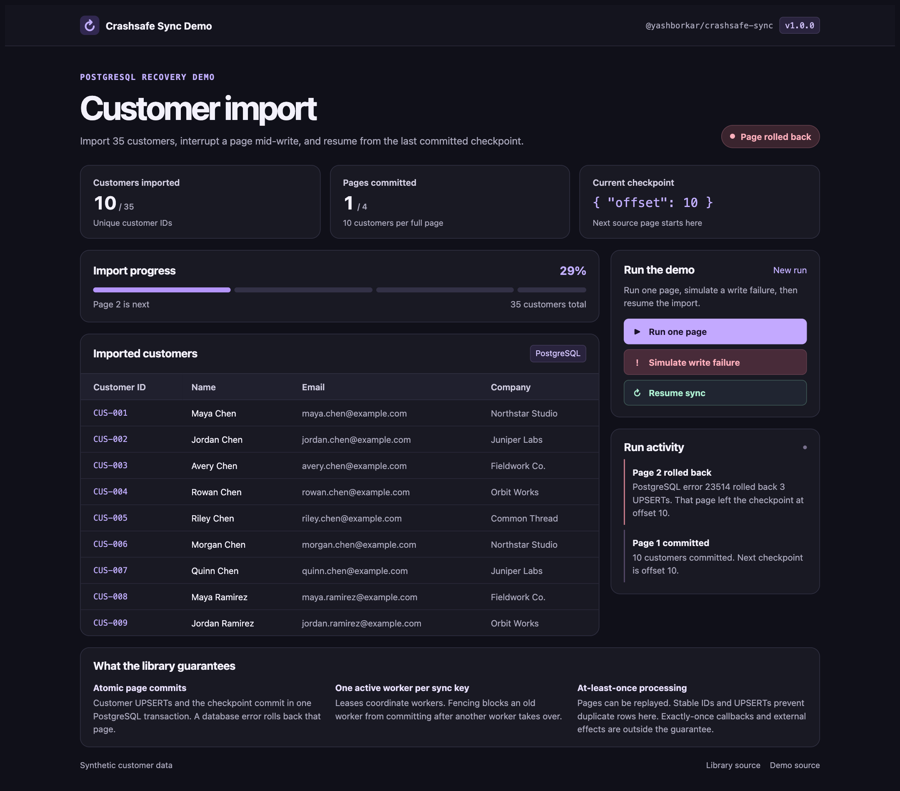

# Crashsafe Sync Demo

An interactive PostgreSQL recovery demo for [`@yashborkar/crashsafe-sync@1.0.0`](https://www.npmjs.com/package/@yashborkar/crashsafe-sync/v/1.0.0). The dashboard reads committed customer rows and the persisted checkpoint from PostgreSQL. The simulated source serves 35 deterministic customers across four pages of 10, 10, 10 and 5.



## Run locally

Use Node.js 20.12+ (Node 22 recommended) and Docker with Compose.

```sh
git clone https://github.com/yashmborkar/crashsafe-sync-demo.git
cd crashsafe-sync-demo
cp .env.example .env
docker compose up -d --wait
npm ci
npm run migrate
npm start
```

Open [http://localhost:3000](http://localhost:3000). PostgreSQL listens on the local machine at port 54329. The Compose database uses passwordless local demo access and binds to loopback. If you already have PostgreSQL, skip Compose and set `DATABASE_URL` in `.env` to a dedicated demo database before running the migration.

## Try the recovery sequence

| Click | Customers | Pages committed | Checkpoint |
| --- | ---: | ---: | --- |
| **Run one page** | 10 | 1 | `{"offset":10}` |
| **Simulate write failure** | 10 | 1 | `{"offset":10}` |
| **Resume sync** | 35 | 4 | `null` (source exhausted) |

The failure attempt writes three rows inside the page transaction, then violates a PostgreSQL check constraint (SQLSTATE `23514`). The package rolls back the three UPSERTs. Resume retries page 2 from offset 10 and commits the three remaining pages. The completed run contains 35 distinct customer IDs. [View the completed dashboard](docs/screenshots/completed.png).

You can reload after the failure and continue the same run in that tab. **New run** opens a fresh import with its own sync key and customer rows. Previous runs stay in the database. Only synthetic data is used.

## How it works

- [`src/source.mjs`](src/source.mjs) simulates the source’s pagination contract. To inspect a page independently, open [`/api/source?offset=10`](http://localhost:3000/api/source?offset=10). The sync calls the same source adapter in-process.
- [`src/demo.mjs`](src/demo.mjs) imports `createSync` and `PgSyncStore` from the pinned registry package. Every customer UPSERT uses the `tx` passed to `writeBatch`, with a unique key on `(run_id, external_id)`.
- [`npm run migrate`](src/migrate.mjs) applies the checkpoint SQL shipped in the installed package and the [demo customer migration](migrations/002_customers.sql). The migration command can be run again against the same database.

The PostgreSQL adapter commits a page’s writes and cursor together. Leases coordinate one active worker per sync key, and fencing rejects a stale worker after takeover. A page may be handled more than once. This demo’s stable IDs and UPSERTs prevent duplicate customer rows. Exactly-once callbacks, external effects such as emails, and writes on other database connections fall outside the transaction guarantee.

## Tests

With the local Compose database running, create the dedicated test database once and run the suite.

```sh
docker compose exec -T postgres createdb -U crashsafe crashsafe_demo_test
npm test
```

Each test suite uses a fresh, temporary schema in `TEST_DATABASE_URL`. The tests exercise the real HTTP routes and PostgreSQL adapter, verify the same customers and checkpoint after a SQL failure, assert all 35 expected IDs after resuming, and explicitly replay a page against existing rows. They also cover failure on the initial and final pages, run isolation, and invalid source cursors. GitHub Actions runs the suite on Node 20 and 22.

## Publish a live demo on Render

1. In your [Render dashboard](https://dashboard.render.com/), create a dedicated [PostgreSQL database](https://render.com/docs/postgresql-creating-connecting). Choose an instance plan and region that keep it available through the assignment review.
2. Create a [Node Web Service](https://render.com/docs/deploy-node-express-app) from this repository’s `main` branch in the same region. Use the following settings.

   | Setting | Value |
   | --- | --- |
   | Build command | `npm ci` |
   | Start command | `npm run migrate && npm start` |
   | Health check path | `/health` |
   | `HOST` | `0.0.0.0` |
   | `DATABASE_URL` | The database’s internal connection string, set as a secret |
   | `PORT` | Provided by Render |

3. After deployment, open the service’s HTTPS URL and confirm `/health` returns `{"status":"ok"}`. Repeat the three-button sequence above, then include the HTTPS URL in your submission.

Use this public demo only with its dedicated database. Each browser run creates its own synthetic records, so storage grows as visitors start new runs. Keep the database connection string in the hosting environment.
